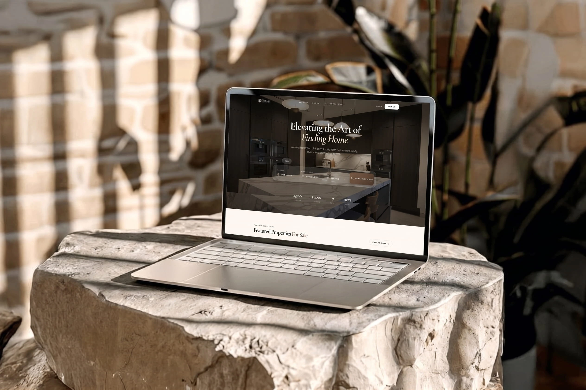

# NestLux — Premium Real Estate Marketplace



NestLux is a high-end real estate marketplace specifically curated for the Moroccan market, focusing on iconic destinations like Marrakech, Casablanca, and Rabat. It bridges the gap between traditional charm and contemporary luxury, offering a seamless experience for both buyers and property owners.

## ✨ Key Features

- 🏢 **Bespoke Marketplace**: A unified dashboard for users to manage their listings, inquiries, and profile.
- 🗺️ **Interactive Maps**: Precise property geolocation using Leaflet.js, featuring custom-branded markers.
- 🔍 **SEO-Friendly URLs**: Human-readable property slugs (e.g., `/properties/luxury-riad-marrakech-x8y2`) for better searchability.
- 💬 **Direct Inquiries**: Integrated messaging system allowing potential buyers to contact owners directly.
- ❤️ **Favorites System**: Save and manage a personalized collection of dream properties.
- 🔒 **Secure Authentication**: Robust auth flow with Supabase, including secure password recovery and profile management.
- 📱 **Mobile-First Design**: A premium, responsive UI built with a focus on aesthetics and micro-animations.

## 🛠️ Tech Stack

- **Frontend**: [React](https://reactjs.org/) + [TypeScript](https://www.typescriptlang.org/) + [Vite](https://vitejs.dev/)
- **Styling**: Vanilla CSS + [Tailwind CSS](https://tailwindcss.com/)
- **Animations**: [Framer Motion](https://www.framer.com/motion/)
- **Backend/Auth**: [Supabase](https://supabase.com/)
- **Maps**: [Leaflet](https://leafletjs.com/) + [React Leaflet](https://react-leaflet.js.org/)
- **Icons**: [Lucide React](https://lucide.dev/)
- **State Management**: [React Query](https://tanstack.com/query/latest)

## 🚀 Getting Started

### Prerequisites

- Node.js (v18+)
- npm or yarn
- A Supabase project

### Installation

1. **Clone the repository**
   ```bash
   git clone https://github.com/yourusername/nestlux.git
   cd nestlux
   ```

2. **Install dependencies**
   ```bash
   npm install
   ```

3. **Set up environment variables**
   Create a `.env` file in the root directory and add your Supabase credentials:
   ```env
   VITE_SUPABASE_URL=your_supabase_url
   VITE_SUPABASE_ANON_KEY=your_supabase_anon_key
   VITE_SITE_URL=https://nestlux.vercel.app
   ```

4. **Run the development server**
   ```bash
   npm run dev
   ```

## 📄 License

This project is licensed under the MIT License - see the [LICENSE](LICENSE) file for details.

---

*Crafted with ❤️ for the Moroccan Real Estate Market.*
